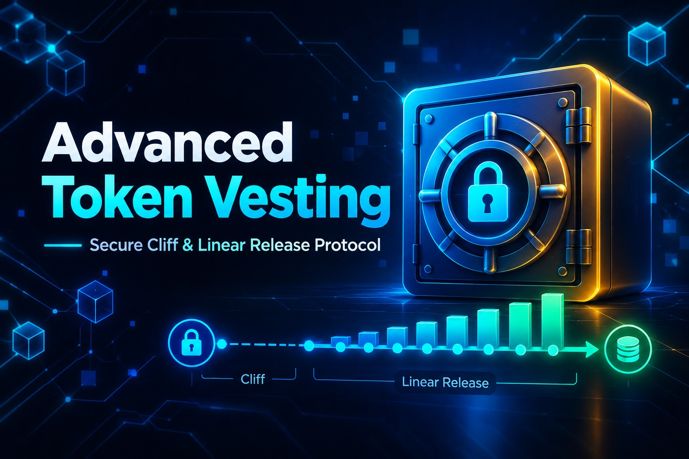

# 🚀 Advanced Token Vesting Protocol

A professional, production-ready Token Vesting Smart Contract built with **Solidity** and tested using **Python (Web3.py)**. 

This repository provides a complete, secure, and highly customizable vesting solution for Web3 projects, teams, and investors. It allows project owners to lock tokens and release them gradually to beneficiaries over time.

## ✨ Key Features (Why choose this?)

- **⏳ Cliff & Linear Release:** Implements a standard vesting schedule with an initial lock-up period (Cliff). Once the cliff is reached, tokens are released linearly over the vesting duration.
- **🔒 Security First:** Built with custom `nonReentrant` modifiers to prevent reentrancy attacks, ensuring user funds are always safe. Also includes a safe token transfer mechanism.
- **👑 Owner Controls:** Includes an `onlyOwner` modifier allowing the contract deployer to create grants and revoke unvested tokens in case of emergencies.
- **📊 Real-time Tracking:** Includes a `vestedAmount(address)` view function to check the current amount of claimable tokens at any given time.
- **⚙️ Automated Deployment & Testing:** Comes with a complete Python script (`vesting.py`) to automatically compile, deploy, and simulate the entire vesting lifecycle locally using Ganache.

## 🛠 Tech Stack
- **Smart Contracts:** Solidity `^0.8.0`
- **Blockchain Interaction:** Python, `web3.py`
- **Compiler:** `py-solc-x`
- **Local Testing:** Ganache

## 📦 What's Included in this Package?
When you purchase this package, you get:
1. `vesting.py`: The complete Python script containing the Solidity code, compiler, deployer, and full local testing simulation.
2. `README.md`: Full documentation (this file).

## 🚀 How to Run and Test Locally

Follow these simple steps to test the smart contract on your local machine:

### 1. Prerequisites
- Python 3.8+ installed.
- [Ganache](https://trufflesuite.com/ganache/) installed and running on `http://localhost:7545`.

### 2. Install Dependencies
Open your terminal and run:
```bash
pip install web3 py-solc-x
